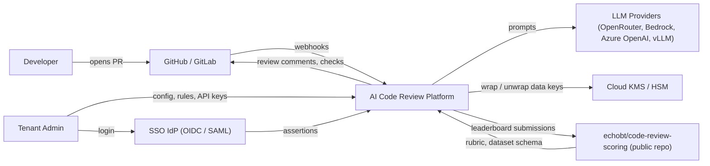
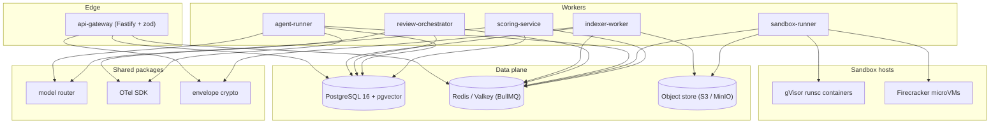
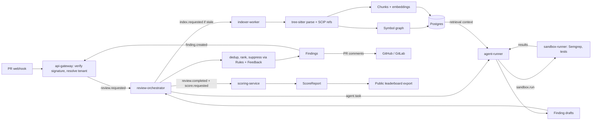
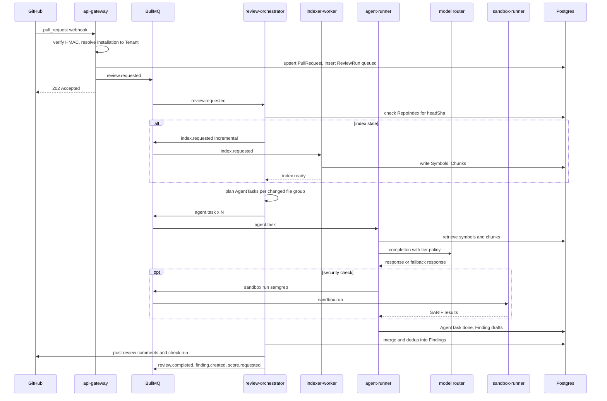
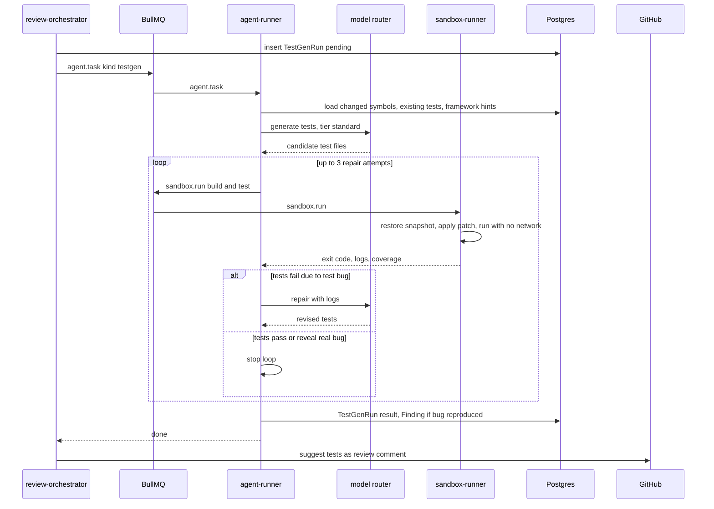
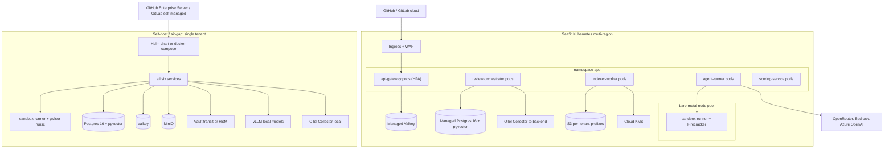
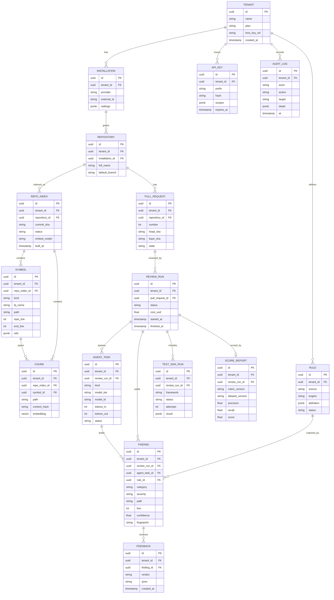

# Architecture: AI Code Review + Security Platform (Backend)

Status: PROPOSAL (v0.1, 2026-10-11) for the design. What is implemented now (and what is stubbed) is tracked in [IMPLEMENTATION-STATUS.md](IMPLEMENTATION-STATUS.md).

## 0. Fact vs Proposal

| Item | Kind | Notes |
|---|---|---|
| Monorepo with the six services and shared packages below | FACT | See [IMPLEMENTATION-STATUS.md](IMPLEMENTATION-STATUS.md). |
| Public scoring repo `github.com/echobt/code-review-scoring` hosts rubric, dataset schema, leaderboard | FACT (external) | We consume and publish to it; we do not own its release cadence. |
| GitHub/GitLab deliver PR webhooks; GitHub Apps use installation tokens | FACT (platform behavior) | |
| Postgres RLS, pgvector HNSW, BullMQ, tree-sitter, gVisor `runsc`, Firecracker, Semgrep OSS, OpenTelemetry exist and behave as documented upstream | FACT (upstream) | Versions pinned in Phase 0. |
| Everything else: service split, queues, schemas, routing policy, deployment | PROPOSAL | Ratified via ADRs 0001-0007. |

## 1. Goals and non-goals

Goals:
- Review PRs with whole-repo context (symbol graph + semantic retrieval), produce line-anchored findings with low noise.
- Hybrid security analysis: Semgrep OSS deterministic rules plus LLM triage/dedup/explanation.
- Generate and execute tests in an isolated sandbox to validate findings and suggest tests.
- Score review quality against a public rubric/dataset and publish to a leaderboard.
- Multi-tenant SaaS and single-tenant self-host / air-gapped deployments from one codebase.

Non-goals (v1): IDE plugin, auto-merge, non-git VCS, training our own foundation models.

## 2. Fixed technology decisions

| Concern | Choice | ADR |
|---|---|---|
| Language/runtime | TypeScript on Node 24, pnpm workspaces | [0001](adr/0001-language-runtime.md) |
| API | Fastify + zod | 0001 |
| Queue | BullMQ on Redis/Valkey | [0002](adr/0002-queue.md) |
| DB + vectors | PostgreSQL 16 + pgvector (HNSW) | [0003](adr/0003-vector-store.md) |
| Code parsing | tree-sitter symbol graph, optional SCIP for precise refs | [0004](adr/0004-ast-parsing.md) |
| Sandboxing | Docker + gVisor (`runsc`) self-host, Firecracker microVMs SaaS | [0005](adr/0005-sandboxing.md) |
| Models | OpenAI-compatible provider abstraction: OpenRouter (incl. `deepseek/deepseek-v4.1-flash` cheap tier), Bedrock, Azure OpenAI, vLLM; per-task tier policy, budget caps, fallback | [0006](adr/0006-model-routing.md) |
| Tenancy | Postgres RLS on `tenant_id`, per-tenant envelope encryption (KMS), per-tenant queue/object prefixes | [0007](adr/0007-multi-tenant-isolation.md) |
| SAST | Semgrep OSS + LLM triage | ARCHITECTURE section 6 |
| Observability | OpenTelemetry (traces, metrics, logs) | ARCHITECTURE section 9 |

## 3. Services

| Service | Responsibility | Consumes | Produces |
|---|---|---|---|
| `api-gateway` | Fastify + zod. Webhooks (GitHub/GitLab), REST API, ApiKey auth, tenant resolution, rate limits, audit log | HTTP | `index.requested`, `review.requested` |
| `indexer-worker` | Clone/fetch, tree-sitter parse, symbol graph, optional SCIP ingest, chunking, embeddings into pgvector | `index.requested` | RepoIndex, Symbol, Chunk |
| `review-orchestrator` | Builds ReviewRun plan from diff + context, fans out AgentTasks, merges/dedups findings, posts PR comments | `review.requested`, agent results | `agent.task`, `review.completed`, `finding.created`, `score.requested` |
| `agent-runner` | Executes AgentTasks (reviewer, security triage, test-gen) via model router, tool calls (retrieve, read file, run sandbox) | `agent.task` | Finding drafts, `sandbox.run` |
| `sandbox-runner` | Runs Semgrep, builds, and generated tests in gVisor/Firecracker with no network by default | `sandbox.run` | Execution results, TestGenRun updates |
| `scoring-service` | Scores ReviewRuns against rubric/dataset from `echobt/code-review-scoring`; produces ScoreReport; exports leaderboard submissions | `score.requested`, `review.completed`, Feedback | ScoreReport |

Shared packages (pnpm workspace, PROPOSAL): `@platform/schemas` (zod), `@platform/db` (migrations, RLS helpers), `@platform/queue` (typed BullMQ wrappers, tenant prefixing), `@platform/models` (provider router), `@platform/telemetry` (OTel bootstrap), `@platform/crypto` (envelope encryption).

### Queues and events

| Name | Type | Producer | Consumer | Payload (zod, abbreviated) |
|---|---|---|---|---|
| `index.requested` | job | api-gateway, review-orchestrator | indexer-worker | tenantId, repositoryId, commitSha, mode (full or incremental) |
| `review.requested` | job | api-gateway | review-orchestrator | tenantId, pullRequestId, headSha, baseSha, trigger |
| `agent.task` | job | review-orchestrator | agent-runner | tenantId, reviewRunId, agentTaskId, kind, tier |
| `sandbox.run` | job | agent-runner, review-orchestrator | sandbox-runner | tenantId, runId, image, command, limits |
| `score.requested` | job | review-orchestrator, scoring-service cron | scoring-service | tenantId, reviewRunId or datasetId, rubricVersion |
| `review.completed` | event | review-orchestrator | scoring-service, api-gateway (webhooks out) | tenantId, reviewRunId, findingCount |
| `finding.created` | event | review-orchestrator | api-gateway (notifications), scoring-service | tenantId, findingId, severity |

Queue keys are prefixed `t:{tenantId}:` for per-tenant fairness and isolation (ADR 0007). Events are published as BullMQ jobs on fan-out queues `evt.review.completed` / `evt.finding.created` (ADR 0002).

## 4. Diagrams

### 4.1 System context

### 4.2 Component / container

### 4.3 Data flow: PR to score

### 4.4 Review run sequence

### 4.5 Test generation sequence

### 4.6 Deployment topology

### 4.7 Data model

All tenant-owned tables carry `tenant_id` with RLS enabled (ADR 0007). `Tenant` itself is the root.

### 4.8 Scoring pipeline

```mermaid
flowchart LR
    SRC["echobt/code-review-scoring: rubric + dataset schema"] --> SYNC["scoring-service: pin rubric_version and dataset_version"]
    SYNC --> DS["Benchmark dataset: PRs with labeled ground-truth issues"]
    DS --> REPLAY["Replay PRs through review-orchestrator (tenant bench)"]
    REPLAY --> FIND["Findings per PR"]
    LIVE["Live ReviewRuns + Feedback (opt-in)"] --> FIND
    FIND --> MATCH["Match findings to ground truth: location + semantic judge"]
    MATCH --> MET["Metrics: precision, recall, F1, severity-weighted, noise rate, cost, latency"]
    MET --> RUB["Apply rubric weights"]
    RUB --> REP["ScoreReport"]
    REP --> GATE{"Regression vs baseline?"}
    GATE -->|yes| BLOCK["Block model/prompt rollout"]
    GATE -->|no| PUB["Export leaderboard JSON"]
    PUB --> PRLB["PR to echobt/code-review-scoring leaderboard"]
```

## 5. Indexing (PROPOSAL)

- Full index on install; incremental on push using changed-file set from git diff. Content-hash dedup: Chunks with unchanged `content_hash` reuse embeddings.
- tree-sitter grammars per language produce definitions/references heuristically; when a SCIP index is available (CI-uploaded or built in sandbox via `scip-typescript`, `scip-java`, etc.), precise refs override heuristic refs (ADR 0004).
- Chunking at symbol boundaries (function/class), max ~1.5k tokens, with file-header context.
- Embeddings via model router `embed` task tier; dimension fixed per `RepoIndex.embed_model`. HNSW index per embedding dimension, filtered by `tenant_id` + `repo_index_id` (ADR 0003).
- Source code is never stored unencrypted at rest: object-store blobs encrypted with tenant DEK; Chunk text column encrypted, embeddings stored in clear (required for ANN) and treated as sensitive.

## 6. Review engine (PROPOSAL)

- Planner (cheap tier) groups the diff into review units; each unit gets an AgentTask with context = diff hunk + callers/callees from symbol graph (depth 2) + top-k semantic Chunks.
- Agent kinds: `review.general`, `review.security`, `triage.semgrep`, `testgen`, `summary`, `judge` (scoring only).
- Semgrep OSS runs in sandbox over changed files with tenant Rules + curated registry snapshot (vendored for air-gap). LLM triage classifies each SARIF result as true/false positive with reachability reasoning; only triaged-true or high-confidence results become Findings.
- Merge: fingerprint = hash(path, normalized line window, category, normalized message); dedup across agents; suppress fingerprints with negative Feedback in the same repo; cap comments per PR (default 15) by severity x confidence.
- Prompt-injection guard: repo content is untrusted input; tool calls are allow-listed; agents cannot reach network or secrets; output is schema-validated by zod before persistence.

## 7. Model routing (PROPOSAL, ADR 0006)

| Task | Default tier | Example primary | Fallback |
|---|---|---|---|
| plan, summary, triage.semgrep, dedup | cheap | `deepseek/deepseek-v4.1-flash` via OpenRouter | Bedrock cheap model |
| review.general, review.security, testgen | standard | frontier model via OpenRouter / Azure OpenAI | alternate provider same tier |
| hard security escalation, judge | premium | top model via Bedrock / Azure | standard tier + flag |
| embed | embed | tenant-configured embedding model | none (fail index job, retry) |

Implementation tier names (`@review/core` `ModelTier`): cheap = `small`, standard = `medium`, premium = `large`, plus the separate `embed` route.

Budget caps per tenant per month and per ReviewRun; on cap, downgrade tier then stop with partial review. Self-host routes all tiers to vLLM.

## 8. Security and tenancy (PROPOSAL, ADR 0007)

- Every request/job carries `tenantId`; DB sessions `SET LOCAL app.tenant_id` inside a transaction; RLS policies `tenant_id = current_setting('app.tenant_id')::uuid`. Services connect as non-owner role without `BYPASSRLS`.
- Envelope encryption: per-tenant KEK in KMS (Vault transit in self-host); DEKs cached in memory with short TTL; encrypts installation tokens, source blobs, Chunk text, prompts/responses retained for audit.
- Queue keys `t:{tenantId}:...`, object keys `tenants/{tenantId}/...`, with IAM policies per prefix where the store supports it.
- ApiKeys stored as prefix + argon2id hash; scopes; AuditLog append-only (no UPDATE/DELETE grant).
- LLM data handling: zero-retention provider settings where available; per-tenant provider allow-list.

## 9. Observability (PROPOSAL)

- OTel SDK in every service; trace context propagated through BullMQ job data (`traceparent`). Span attributes: `tenant.id` (hashed in exported telemetry), `review_run.id`, `model.id`, `tokens.in/out`, `cost.usd`.
- SLOs: p95 webhook-to-first-comment < 5 min for PRs < 1k changed lines; gateway availability 99.9%.

## 10. Open questions

- Event bus: stay on BullMQ fan-out or add NATS/Kafka when external consumers appear (revisit in ADR 0002 at > 10 consumers).
- Separate vector store at > 500M Chunks (ADR 0003 revisit trigger).
- GitLab parity timeline.
