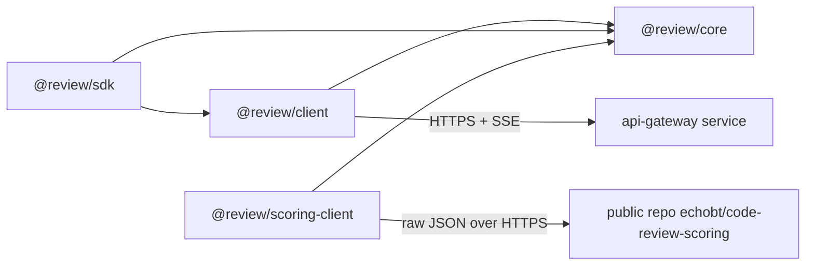

# SDKs (TypeScript)

Status: **FACT** for what exists in `packages/` (compiles with `typescript@5.9.3`, tests pass - see `build.json`); **PROPOSAL** for the roadmap section.

## Packages

| Package | Role | I/O | Depends on |
|---|---|---|---|
| `@review/core` | zod schemas + inferred types: domain (`Finding`, `Review`, `Severity`, `Rule`, `RepoIndex`, `TestGenRun`, `ScoreReport`), REST contracts, SSE events, queue messages | none | `zod` |
| `@review/client` | typed REST/SSE client (`ReviewClient`) | `fetch` | core |
| `@review/sdk` | high-level API: `reviewPullRequest`, `reviewDiff`, `indexRepo`, `generateTests`, `scoreReview`; auth via env/secret file | via client | core, client |
| `@review/scoring-client` | public scoring repo client + reference scorer | `fetch` (public, no auth) | core |



## Conventions (FACT, enforced by config)
- ESM only (`"type": "module"`), TypeScript strict, `noUncheckedIndexedAccess`, `erasableSyntaxOnly` (sources run directly under Node's type stripping).
- Every boundary parses with zod: requests before sending, responses before returning, queue messages before handling.
- No secrets in code. Keys: `REVIEW_API_KEY` / `REVIEW_API_KEY_FILE` (SDK), `OPENROUTER_API_KEY` / `OPENROUTER_API_KEY_FILE` (backend, validation harness).
- Tests: `node:test`, no network: client tests hit a real local `node:http` server; SDK tests inject `fetch`.
- Shared route table `routes` in core keeps gateway and client paths in sync.

## Commands
```sh
pnpm install
pnpm typecheck   # tsc -p per package (noEmit)
pnpm test        # node --test per package
```

## Roadmap (PROPOSAL)
- Build step (`tsc` emit to `dist/` + `exports` conditions) before publishing to npm; today `exports` points at `.ts` sources for workspace use.
- Generate an OpenAPI 3.1 document from the zod schemas (e.g. `zod-openapi`) so non-TS SDKs (Python, Go) can be generated.
- Webhook signature verification helper in `@review/sdk`.
- Retry with jittered backoff for idempotent GETs; resumable SSE via `Last-Event-ID`.
